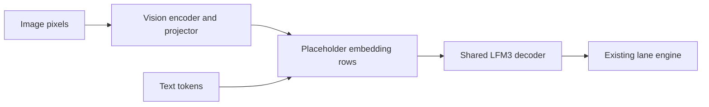

# LFM3 native Metal bring-up

Tracking issue: [#1491](https://github.com/ashhart/TensorFold/issues/1491).

The native Metal engine implements LFM3-1.7B text generation and LFM3-VL-2B image-to-text generation.
Both read the official MLX affine 4-, 6-, and 8-bit checkpoints without converting stored weights.
This is an experimental family port. Device and model checks cover an M4 Pro and an M5 Ultra; they do not qualify other Apple GPUs.

## Weight licence

The official text and VL MLX exports retain the **LFM Open License v1.0**, rather than TensorFold’s Apache-2.0 code licence.
See the [text weights licence](https://huggingface.co/LiquidAI/LFM3-1.7B-MLX-4bit/blob/main/LICENSE) and
[VL weights licence](https://huggingface.co/LiquidAI/LFM3-VL-2B-MLX-4bit/blob/main/LICENSE).
The checked Macs are an M4 Pro with 48 GB RAM and an M5 Ultra with 256 GiB RAM.

## Run the models

Build the native engine with the Zig version in `.zig-version` and Xcode's Metal toolchain:

```sh
zig build native -Dcpu=apple_m1
./zig-out/native/bin/tensorfold-native serve LiquidAI/LFM3-1.7B-MLX-4bit --context 8192
./zig-out/native/bin/tensorfold-native serve LiquidAI/LFM3-VL-2B-MLX-4bit --context 8192
```

Replace `4bit` with `6bit` or `8bit` for those exports. A complete local checkpoint folder also works.
The VL checkpoint loads its own image tower. Send images through OpenAI `image_url` content parts.
The default image budget is 256 tokens per request, with at most four images.
Video input is not implemented. JPEG and WebP decoding require the matching shared decoder libraries.

The shared lane engine handles target verification, sampling and concurrent streams.
Convolution history and KV state are kept per stream; partial acceptance restores the accepted row's state.
Raw prompts of at least 256 tokens can build a repeat-cache entry: the first request records interest,
the second keeps a prefix state, and a later repeat resumes it. Image cache identity includes image content and grid.



## The bf16 releases: d1-2B and LFM3-VL-2B

The bf16 releases as published (no quantization entry in `config.json`, transformers 5's `model.language_model.`
layout) load on Metal beside the MLX exports: [`LiquidAI/LFM3-VL-2B`](https://huggingface.co/LiquidAI/LFM3-VL-2B)
at `ba44bd51db20a2753f28c273a1571ccaa210d954` chats with images, and [`LiquidAI/d1-2B`](https://huggingface.co/LiquidAI/d1-2B)
at `cfe5760ff5d5998f91d9ac56bd4b2dbd96996d41` (an `lfm3_vl` checkpoint with `d1_*` settings) decides.

```sh
./zig-out/native/bin/tensorfold-native serve MODELS/LFM3-VL-2B --vision --vision-image-tokens 1600 --no-thinking --context 8192
./zig-out/native/bin/tensorfold-native serve MODELS/d1-2B
```

- Projections read the stored bf16 matrices: up to 32 rows on register kernels (Spark2.5's `sp_matvec`), more on the
  tensor-unit GEMM (`gemm_nax`, fp32 sums); a prompt chunk is 512 rows. The tied head is the embedding.
- `--vision-image-tokens 1600` gives each picture the processor's own reach (smart_resize, 1280 x 1280 at most);
  the default 256 resizes larger pictures down. `logprobs` and `top_logprobs` are served for every LFM3 checkpoint.
- The image tower's products take the same GEMM (an image's rows fill it), its attention stages 32 keys a threadgroup
  (`l3v_attention_tiled`, bit for bit the row loop), and a decision's pictures run through the tower together.
- d1 serves `/v1/systemone` and `/v1/decisions` (`zig/src/native/lfm3_d1.zig`): the answer slot opens with
  `<think></think>`, option scores take `calibration.json`'s temperature, up to 16 pictures a decision (each under
  `d1_vision_max_pixels`, Pillow's bicubic then smart_resize). `d1_attention: "set"` packs up to `d1_set_size`
  questions after their state in one pass: on full-attention layers the state reads everything and a question its
  state and itself (`lfm3_set_attention`); convolution and sliding layers stay causal. `TF_D1_ATTENTION=causal` reads
  one question a pass. A label's logit is the final row against the bf16 head in float64, not a bf16 logits row.

Receipt, M5 Ultra, against transformers 5.21 running each checkpoint's own code on the same Mac (fp32 on the CPU, bf16
on MPS); the GPU was shared with other work throughout:

- d1 (`set`, the checkpoint's reading), against fp32: the 52 router turns pick fp32's route 52 of 52, probabilities at
  most 0.0072 apart (transformers bf16: 52 of 52, 0.0152); six yes/no pairs 0.0036 (0.0039); 20 synthetic clips x 3
  questions agree 59 of 60 at 4 frames, at most 0.038 and 0.0040 on average apart (bf16: 58 of 60, 0.047, 0.0055),
  and 59 of 60 at 8 frames, 0.022 and 0.0034 (bf16: 60 of 60, 0.015, 0.0026); clip accuracy 0.80 as the reference.
  Read causally (`TF_D1_ATTENTION=causal`, against fp32's causal reading): routes 52 of 52, 0.0099 (bf16 0.0155).
- d1 latency, a request end to end, median of 10: one question 19.1 ms, the router 21.1 ms, three questions over 4
  and 8 frames (448 x 252) 69.4 and 123.1 ms (transformers bf16 on MPS: 20.0, 29.3, 77.6 and 123.3 ms).
- LFM3-VL-2B, 44 synthetic stills with a camera question each, greedy, 48 tokens: replies identical to fp32 on 42
  of 44 (transformers bf16: 41) and to transformers bf16 on 43; teacher-forced along the engine's tokens, its top-20
  probabilities sit 0.000264 from fp32 on average (bf16 0.000318), 0.0053 a row (bf16 0.0063, its cached decode rows
  0.0062), and it picks fp32's top token on 538 of 540 rows (bf16 537; the two misses 0.18 and 0.043 nats apart).
  The largest single difference is 0.135 (bf16 0.092), the prompt's last row at most 0.0080 (bf16 0.0062).
- Eight text-only prompts: short, 0.000615 from fp32 a probability (bf16 0.000603), 237 of 238 top tokens (bf16 234);
  after a 420-token passage, 0.000606 (bf16 0.000604) and 261 of 270 (bf16 265), a row 0.0121 (bf16 0.0121, its
  cached decode rows 0.0126). The passage repeats one sentence, so near ties are many.
- LFM3-VL-2B, camera answers (36 questions, one 640 x 480 picture each, no prompt cache): first word 0.082 s, the
  whole answer 0.163 s (transformers bf16 on MPS: 0.074 s and 0.164 s); a decode row about 6.4 ms.
- The GEMM against the register kernels on the same rows: 14 to 20 of 65,536 bf16 outputs differ by one rounding,
  with the same mean error from float64 (K 1024 to 4096); its sums are fp32.

The bf16 weights are under the LFM Open License v1.0, as the MLX exports.

## Inspect a checkpoint

Use Python 3.11 or newer. The inspector uses the standard library. It resolves a full Hugging Face commit,
reads the config and index, and requests only the safetensors headers. It refuses a server that returns a
complete weight file instead of the requested byte range.

```sh
python3 tools/lfm3/inspect_checkpoint.py LiquidAI/LFM3-1.7B-MLX-4bit --output text4.json
python3 tools/lfm3/inspect_checkpoint.py LiquidAI/LFM3-VL-2B-MLX-4bit --output vl4.json
```

Replace `4bit` with `6bit` or `8bit` to inspect those exports. Pass `--revision COMMIT` to repeat a pinned inspection.
Use `--local-dir MODEL_DIR` instead of a repository name to inspect files already on disk.

## Check the native text layout

Use the Zig version in `.zig-version`.

```sh
zig build test-lfm3-host tf-lfm3-check
./zig-out/bin/tf-lfm3-check text4.json
./zig-out/bin/tf-lfm3-check vl4.json
python3 -m unittest discover -s tools/lfm3 -p 'test_*.py' -v
```

The native checker reads the saved metadata, validates shard header geometry, and checks the LFM3 text decoder's
required names, dtypes, shapes, and byte counts. It performs no projection, GPU allocation, or model inference.
For VL, it checks the text decoder only. A passing result does not validate vision weights or image processing.

The config reader preserves full-attention versus sliding-attention layers, distinct rotary settings, sandwich norms,
and each module's affine width and group size. Unsupported geometry and conflicting quantization declarations fail.

## Checkpoint details

All six inspected MLX exports store the decoder under `language_model.model.*`, including the text-only model.
Each decoder has 594 tensors. Convolution kernels are BF16 with shape `[2048, 7, 1]`.

Text 4/6/8-bit and VL 6/8-bit use affine groups of 64. VL 4-bit uses groups of 32 and an 8-bit embedding override.
The 138 additional VL vision/projector tensors are BF16 in all three exports. Global quantization metadata must not
cause these dense tensors to be treated as packed affine weights.

The header inspections used these revisions:

- Text 4-bit: `d0ca73dcfa70ce18733754a492cdc1fb0123262d`.
- Text 6-bit: `26be898c36b545d625d84ac0761c6c3eb664aef3`.
- Text 8-bit: `ee7667f3cfccb2a41725f91820531823fcabc6b7`.
- VL 4-bit: `c823fade98e35a3d6942ad4d38b1ea15f675cd12`.
- VL 6-bit: `6d71bfae121abedc75f6d531fc7f6ceb4f5e3501`.
- VL 8-bit: `83336d5be3874a2bdd3297bde77b2114dbd3a816`.

## Qualification and remaining gate

Detailed counts, hashes, numerical evidence and reproducible requests are in the [receipts](../receipts/lfm3/README.md).

All six checkpoints passed 303 greedy/seeded-sampling, cache, concurrency and cancellation checks on one optimized M4 binary.
The final source build also passed 303/303 on an M5. Text4 and VL4 additionally passed real grammar, thinking, tool,
streaming, history and image-conditioned tool checks with the matching optional grammar library.
The 4-bit text long exactness suite passed all 73 cases through 8,193-token seams.
The final family contract passed 50 kernels and caught all 13 real controls, with zero limit problems.

Independent projection audits covered 66 class/layout cells and 60,954,624 outputs with no violations of existing FP32/BF16 bounds.
The row-pair optimization preserves the shared arithmetic: 132 checkpoint calls and a full 8,193-token logit comparison were byte-identical.
On the M5, controlled 4-bit cold requests improved text engine prefill from 1.240 to 0.813 seconds at 2k and
73.402 to 61.633 seconds at 64k; VL decoder requests improved from 1.262 to 0.815 and 73.920 to 59.647 seconds.
These are engine prefill measurements; the receipt also retains client TTFT. All compared full output-token hashes matched.

Native inference retains the checkpoint's BF16 activation boundaries and FP32 reductions.
Text trigonometric values round to BF16 before rotation; vision axial trigonometric values remain FP32.
The CPU FP64 oracle records numerical differences rather than inventing a tie policy.
MLX's vector/matrix quantized paths use different effective reconstruction, and bounded FP32 differences can propagate through history.
See the exact primitive and whole-model evidence before interpreting a next-token mismatch.

```sh
zig build tf-lfm3-forward tf-lfm3-vision tf-lfm3-project tf-lfm3-profile tf-lfm3-exact -Dcpu=apple_m1
./zig-out/bin/tf-lfm3-exact MODEL_DIR --long
python3 tools/lfm3/serve_check.py --binary ./zig-out/native/bin/tensorfold-native --model-dir MODEL_DIR --sampled --cancel --output served.json
```

Long-context model fidelity, maximum image budgets, 6/8-bit performance and other Apple GPU generations remain separate qualification work.
Structured output requires the native grammar library; video is not advertised.
A complete earlier global M5 contract run found one Qwen4 failure that also reproduces on the unchanged pinned base.
It is not a final-source global pass. Agree model-fidelity and performance gates on #1491 before claiming release readiness.
